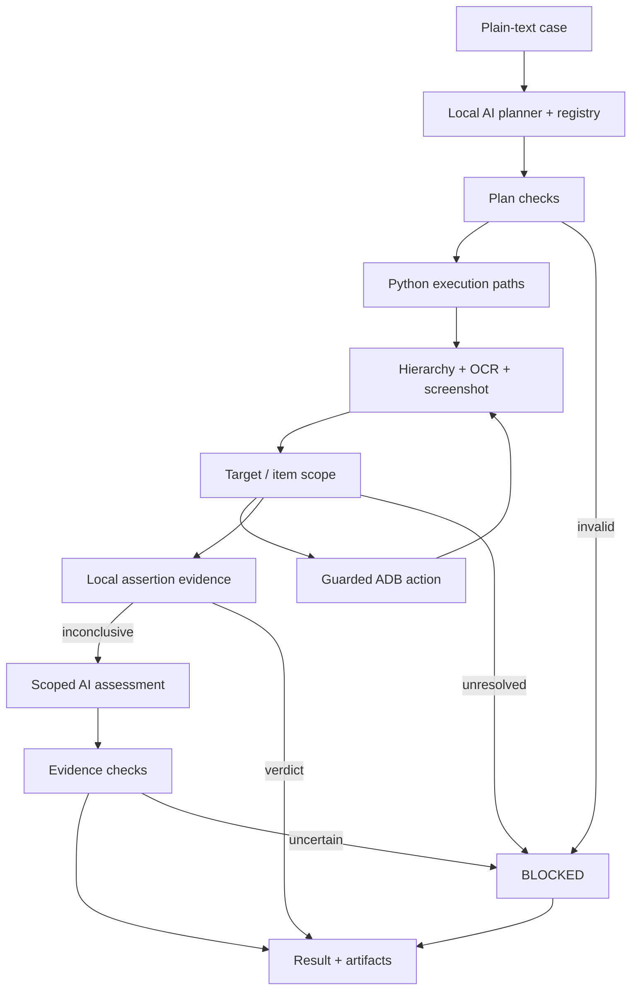

# Mobile AI Testing Agent — Local Plan-Driven PoC

Run supported human-readable Android tests locally using Ollama planning,
Python execution, ADB, UIAutomator2 hierarchy, and Apple Vision OCR.
This is an advisory PoC, not a replacement for release-critical regression.
See [RFC v0](RFC.md) for architecture, trade-offs, ownership, and rollout.

## Nested collection search and captured titles

Every compiled navigation plan includes an optional recovery checkpoint after
its first navigation tap, even when the author omits it. Existing checkpoints
are not duplicated. Independently, the runner checks grounded unexpected
foreground interruptions before each step, resumes the pending step after
recovery, and protects planned modals. Dimming alone does not authorize Back.

Collection IDs are matched exactly before semantic token matching. An explicit
missing ID cannot resolve to another carousel or pass visibility on AI prose.
The planner rejects omitted explicit taps and literal ordinal-title placeholders.
Explicit control-option taps may compile to `set_control` only when their value
and side match the source instruction; they are not missing taps. The model's
case-specific capability schema excludes `seek_item` unless ordinal navigation
is requested. Label assertions do not imply list navigation. Regression checks
compile all five repository cases through the fallback path, including layout
setup/transitions and sorting steps with explanatory `now`/`to apply` wording.

Three reusable capabilities support the swimlane journey:
- `scroll_until_visible`: scroll the parent collection named in `value`, in
  `direction`, until the target collection is grounded; at most five swipes.
- `capture_text`: capture a text field inside a grounded visible ordinal item
  into a named variable. Provide collection and field resource-ID hints when
  the item contains several text fields. `captured-values.json` records its scope.
- `seek_item`: value is a positive ordinal, target is the collection, direction
  is forward, and hints identify the collection and its item identity field.
  It seeks an observed start boundary (two consecutive non-moving observations
  after reverse swipes), then merges overlapping identity windows with small
  swipes. At most twelve total swipes. Later Capture/Tap use `tracked item of
  <collection>` and recheck the same identity on the current hierarchy.
  `item-tracking.json` records windows, bounds, phase and selection.

Use `assert_contains` with `$variable_name` to compare the captured title exactly
with one destination resource-ID field outside the source collection. Missing,
ambiguous or uncaptured evidence blocks; a different title fails.
Alternatively, use `Verify Details screen is open` followed by `Verify Details
screen contains $variable_name`, with no destination resource ID. After a tap
following capture and a completed screen-visibility assertion, the comparison
requires a fresh hierarchy with the source collection absent and searches exact
visible text through hierarchy, then OCR. Missing screen proof or text blocks;
a whole-screen text hit alone cannot establish navigation. Screen identity may
still depend on the existing visual assessor. `*-captured-comparison.json`
records the comparison and its navigation confirmation flag.

Captured-title assertions prefer full normalized title matches (hierarchy,
then OCR). An explicit trailing `…` or `...` may match a prefix of the captured
title after case/whitespace normalization. Prefix evidence requires at least
12 alphanumeric characters, three words and 60% of the full normalized title;
these are conservative heuristics, not a guarantee of unique vendor identity.
Unmarked partial strings, ambiguous visible matches and conflicting full titles
do not pass. Evidence records `match_type: truncated_prefix` and both strings;
it never reports a prefix as an exact full-title match. Existing destination
confirmation and source-collection exclusion still apply.
The shared assertion-polarity guard scopes negation to an evidence clause:
`title matched; source collection absent` does not negate the title match.
Actual expected-value absence still rejects a positive assertion. Expected
labels are protected before clause parsing so punctuation or a word such as
`No` inside a product name does not itself change assertion polarity.

The updated swimlane case targets the third item from the **observed collection
start**, even when only two cards fit on screen. Duplicate identities, lost
overlap, changed order, clipping or exhausted budgets block. The same helper
supports horizontal and vertical lists. The boundary is inferred from observed
non-movement, not an authoritative backend index: stalled gestures can mimic an
edge. It does not prove an absolute fourth parent, and requires live-device
validation on the target layouts.

An unreadable final edge fragment after an already identified target may be
excluded from the selection window; it is recorded in `ignored_edges` and never
counted as an item. Unknown items before the target or inside the sequence still
block. This permits capture/tap of a fully exposed tracked item even when a tiny
piece of the following card has no title node.

## Current scope

| Case | Journey | Evidence status |
|---|---|---|
| `33271746` | Card → row layout | Successful device run observed; legacy structured counters remain incomplete. |
| `33271747` | Row → card layout | Successful device runs observed; legacy structured counters remain incomplete. |
| `33271749` | Rating sorting, filter count, Ad presence/absence, refresh, scroll | Successful reviewed device runs observed; no universal reliability guarantee. |
| `33618516` | Delivery-time sorting | Added case; requires its own reviewed device evidence. |
| `33618525` | Nested horizontal collection → menu | Currently blocked; planning, off-screen/index, and value-comparison gaps remain. |

A generic adapter and collection helpers are reusable building blocks. The
runner still includes legacy flow/layout assumptions and separate execution
paths; it is not a universal executor for arbitrary apps or cases.

## Setup on macOS

Prerequisites: Python 3, Android platform-tools (`adb`), Xcode command-line tools
(`xcrun swiftc`), local Ollama with a vision-capable model, and an unlocked Android
device connected with USB debugging. The staging app must be installed and logged
in. Set the required address/test data and start from the case's preconditions.

```bash
python3 -m venv .venv
source .venv/bin/activate
python3 -m pip install -r requirements-hierarchy.txt

xcrun swiftc \
  -framework Vision \
  -framework Foundation \
  -framework ImageIO \
  tools/screen_ocr.swift -o tools/screen_ocr
chmod +x tools/screen_ocr

ollama pull qwen2.5vl:3b
ollama serve
```

Run `ollama serve` only if Ollama is not already serving. Keep it running in a
separate terminal. Activate `.venv` in every agent terminal; this avoids Homebrew's
`externally-managed-environment` error. Do not bypass it with
`--break-system-packages`. UIAutomator2 brings optional dependencies, including
Pillow; the project is not dependency-free.

Check the connected device and runtime without executing the case:

```bash
adb devices
python3 -m src.main \
  --case cases/33271749-sort-restaurants-list-ratings.txt \
  --hierarchy-backend uiautomator2 --check-only
```

`--check-only` is a readiness check, not proof of successful model inference or
case execution. Use `--serial SERIAL` when more than one device is connected.
The default app ID is `com.hungerstation.android.web.debug`; use `--app-id` to
select another installed package.

## Plan, then execute

```bash
python3 -m src.main \
  --case cases/33271749-sort-restaurants-list-ratings.txt \
  --plan-only

python3 -m src.main \
  --case cases/33271749-sort-restaurants-list-ratings.txt \
  --hierarchy-backend uiautomator2
```

Plan-only mode does not perform device actions. Review that every requested tap,
assertion, direction, scope, and expected value survived compilation. A valid
schema does **not** guarantee faithful interpretation of the source case.

Other current paths:

```text
cases/33271746-card-to-row.txt
cases/33271747-row-to-card.txt
cases/33618516-sort-restaurants-list-delivery-time.txt
cases/33618525-open-swimlanes-in-list.txt
```

Run all case files sequentially:

```bash
bash run_all_tests.sh
```

The suite uses UIAutomator2, suppresses console `DEBUG` messages, continues after
case failures, and groups artifacts by case and attempt. Individual runs keep
DEBUG output by default. Set `MOBILE_AGENT_DEBUG=0` to suppress it explicitly.
The suite requires the `timeout` command on PATH (on macOS, GNU coreutils with
its `gnubin` path provides it). Per-case timeout is 30 minutes. A flaky later-pass
case still counts as passed in the shell summary; inspect result metadata.

## Architecture



Ollama interprets case intent and still assists at runtime with ambiguous
recovery/visual assertions. It does not operate ADB directly. OCR reads rendered
text and bounds; hierarchy supplies resource IDs, relationships, and states.
Python controls effects and checks evidence. Current guards reduce, but do not
eliminate, planning mistakes or false assertion passes.

## Authoring contract

Use supported operation words and explicit product targets/values. AI handles
minor typos and supported paraphrases; arbitrary natural language is not an
unrestricted execution interface. Existing capabilities need no Android/iOS
application-code knowledge to reuse; unsupported interactions need code support.

| Intent | Capability |
|---|---|
| Tap a target | `tap` |
| Recover an optional interruption | `recover_optional` |
| Establish/change a two-state control | `set_control` |
| Scroll / verify scoped movement | `scroll` / `assert_scrolled` |
| Verify visible / hidden / selected | `assert_visible` / `assert_hidden` / `assert_selected` |
| Verify exact scoped text present / absent | `assert_contains` / `assert_not_contains` |
| Verify change / wait for change | `assert_changed` / `wait_changed` |

Fields include `target`, `hints`, `value`, `role`, `direction`, `position`, and
`success`. `set_control` requires a state value. Contains assertions require the
exact expected value and a scoped target. A success description is intent, not
evidence that the condition actually holds.

Example:

```text
Tap Restaurants on Home.
Recover safely from any optional foreground sheet.
Verify that the first restaurant item contains the exact label "Ad".
Tap Filters.
Tap Ratings (High To Low).
Verify Ratings (High To Low) is selected.
Tap Apply.
Verify the Filters pill contains "1".
Verify the Filters sheet is hidden.
Wait until restaurant items change and finish loading.
Verify the first restaurant item does not contain the exact label "Ad".
Scroll down within the vertical restaurant list.
```

### Nested collections and item positions

Use a visible heading or explicit resource-ID hint to distinguish containers.
Dynamic backend headings are optional evidence, not stable selectors. Vertical
scrolls use `up/down`; horizontal swipes use `left/right`. The executor selects
by hierarchy, axis, and heading/ID keywords; it does not substitute the main list
for a horizontal target. Scroll verification is placed directly after its action.

Visible-window ordinal syntax: `second visible item of the horizontal collection`.
This refers to the current on-screen order, **not** an absolute adapter index.
The item must be fully contained in its collection bounds. Missing/clipped items
or ambiguous containers block. Screenshot-only ordinal indexing is unsupported.

Current gaps: exact resource-ID hints such as `horizontal_scroll` can still lose
specificity during keyword resolution; a model can drop ordinal/parent scope from
a plan. Absolute positions across scrolls, bounded search for off-screen targets,
and capture/compare of titles across navigation are not implemented. Add explicit
vertical scrolling before verifying an off-screen collection, but do not treat
that alone as support for the full swimlane journey.

## Observation, recovery, and model evidence

- `--hierarchy-backend uiautomator2` starts a device-side service without app
  changes. It disables idle waiting, requests uncompressed XML, preserves IDs
  and parent links, and bounds snapshots with a 25-second worker timeout.
- `auto` prefers installed UIAutomator2; `adb` uses the legacy shell dump. Do not
  run competing automation sessions on one device. Busy screens may still fail
  capture; supported paths use a fresh screenshot/OCR fallback and re-probe later.
- Legacy `could not get idle state` failures stop identical retries. Diagnostics
  include stdout/stderr, duration, exit/timeout state, and activity/window snapshots.
- Grounded unexpected sheets or Braze messages may be dismissed before a pending
  action, then closure is checked. Planned sheets are protected. Brightness alone
  does not authorize Back; recovery is not guaranteed for every popup/layout.
- Modal assertions can retain container/heading identity across closure; selected
  assertions can use checked/selected state in the grounded option row.
- Change assertions retain a pre-modal baseline when available and compare scoped
  item identities/order or before/after images. Visibility alone does not prove
  refresh. These checks do not validate numerical sorting unless specified and
  supported separately.
- Runtime model evidence is compacted using node tables and recent action summaries.
  Context-size HTTP 400 triggers one compact-evidence retry; other HTTP errors do
  not. A second overflow blocks. Images and assertion polarity are preserved.

Local Ollama uses HTTP on loopback; an HTTP error does not imply cloud inference.
Changing model/hardware/context can change latency and outcomes. A nominal
stability window is not a strict end-to-end deadline when captures take time.

## Assertions and artifacts

Exact observed labels inside a grounded target can establish presence locally.
First-item assertions use hierarchy or bounded OCR layout fallback. Tight label
crops are enlarged; negative checks require coverage of the target item.
**An OCR miss alone is not absence.** Scoped visual AI may still assess absence;
its verdict is not a mathematical proof of complete coverage.

A supplied swimlane run exposed a false-positive visibility assertion when the
requested container was absent. Do not assume all targets are grounded merely
because a step printed PASSED; retain and review provenance.

Artifacts are grouped by run / case / attempt where applicable:

| File | Evidence |
|---|---|
| `plan.json` | Compiled plan at the case/run root. |
| `NN.png`, `NN.xml`, `NN.json` | Screenshot and current hierarchy. |
| `NN-screen-ocr.json` | Full-screen recognized text, coordinates, confidence. |
| `NN-decision.json`, `NN-assessment.json` | Decision and assessment when that path records them. |
| `*-assertion-*.png`, `*-with-border.png`, assertion JSON | Scoped crop, red source border, metadata, final verdict and attempts when a crop is produced. |
| `*-change-step-*` | Before/current images and comparison evidence. |
| `NN-dump-commands.jsonl`, `NN-dump-log.txt` | Hierarchy diagnostics. |
| `result.json`, `step-results.json`, `exception.json` | Results, completed-step evidence, and exception progress when applicable. |

Not every shortcut produces an assertion crop. Observation numbers in filenames
are not plan-step numbers. Terminal headers follow the plan; waits/recovery are
indented. The default 25 execution cycles are an internal budget, not the number
of test steps.

## Retries and remaining limitations

A transient assertion may be re-observed up to three times; a case may run up to
three attempts. Set `--attempts 1` for a single attempt. Later success is PASSED
with `flaky: true`; all unsuccessful attempts are not a recovered flaky success.
Relaunch preserves application data/filters: restore or verify preconditions.

Sequential exceptions preserve prior decision records and completed-step counts.
Legacy layout execution still lacks equivalent structured accounting, so a layout
PASSED result can report zero step/assertion counters. This needs consolidation.
Retries do not fix omitted plan actions, bad scopes, or unsupported capabilities.

## Key files and checks

| File | Job |
|---|---|
| `src/planning.py`, `src/capabilities.py` | Local planning and operation contract. |
| `src/main.py` | Observation, orchestration, device actions, assertions, reports. |
| `src/hierarchy_backend.py` | Bounded UIAutomator2 snapshot worker. |
| `src/adapters/generic_adapter.py`, `src/collections.py` | Reusable grounding and nested collection/item handling. |
| `src/recovery.py`, `src/state_assertions.py` | Modal recovery and grounded modal/selected-state checks. |
| `src/change_evidence.py`, `src/model_evidence.py` | Change baselines and bounded model-request evidence. |
| `src/progress.py`, `src/debug.py` | Plan-based display and debug-output policy. |
| `run_all_tests.sh` | Sequential suite and case/attempt grouping. |

```bash
python3 -m unittest discover -s tests -v
```

Unit/fixture checks do not establish device reliability. Validate with real runs,
manual-outcome agreement, scoped evidence review, and the QA-owned pilot gates in
the RFC. TestRail/Jira/Slack integrations, iOS adapters, and CI admission remain
planned work; maintenance ownership is required before expansion.
