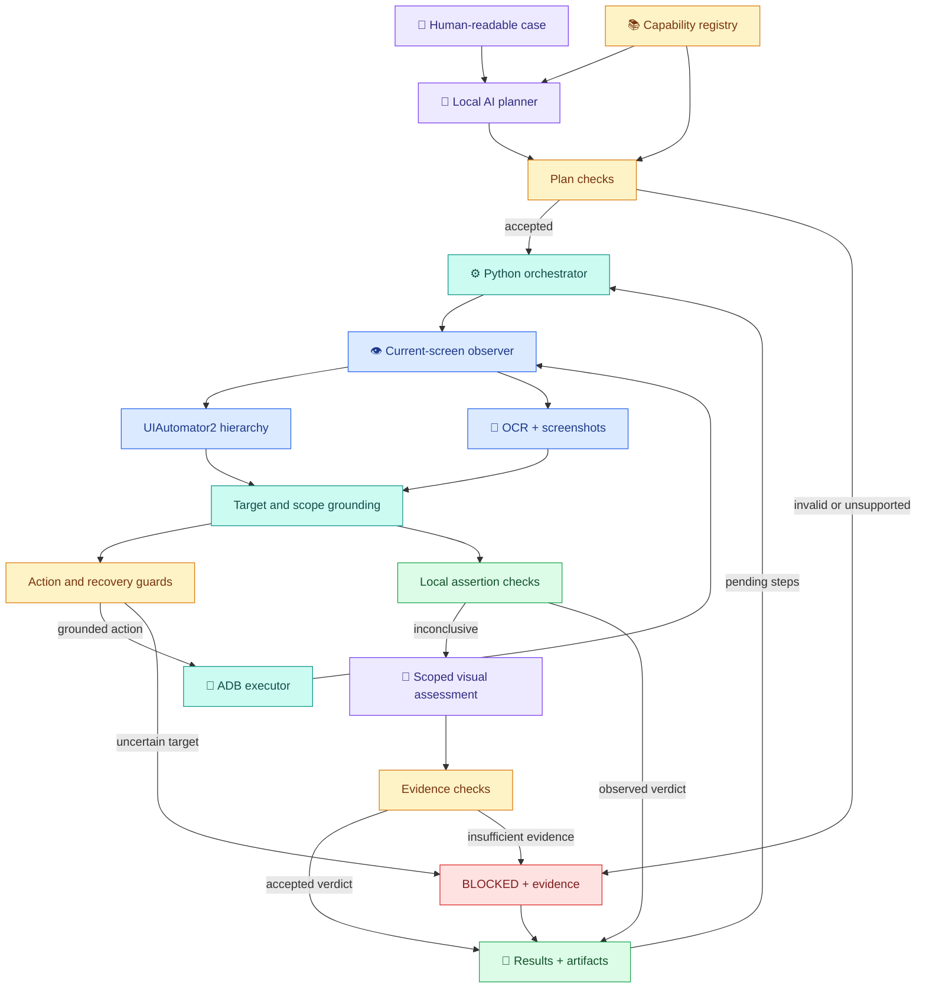

# Hybrid AI Mobile Regression Agent

**RFC v0 · PoC · Mohamed Fadl Allah · Updated 12 October 2026**

**Repository:** https://github.com/mfadlallah/android-test-automator

**Status:** Engineer-local Android pilot; advisory results, not release gating.

## Problem and objective

The friction is well known: an engineer creates a TestRail run, reads each case, manually executes it on the app, and returns to record every result—including passes. Repeated device interaction and result entry consume engineering time. Separate platform automation definitions can also drift from TestRail intent.

The objective is to eliminate manual regression friction for supported journeys: automate execution and evidence capture first, then TestRail reporting. Engineers focus on failures, uncertain outcomes, and test intent. TestRail is the proposed single source of truth; the current PoC reads local plain-text files and does not yet synchronize TestRail.

## Proposal

Use a hybrid agent. A local AI model translates human-readable steps into a capability plan. Python validates the plan, resolves targets against current-screen evidence, and executes device actions. Hierarchy and OCR provide concrete evidence; AI assists with ambiguous recovery and scoped visual assertions. **The model does not directly control the device, and model verdicts remain a source of uncertainty.**

QA and contributors write product intent using a controlled vocabulary: `Tap`, `Scroll`, `Verify ... visible/selected/contains/does not contain`, and `Wait until ... changes`. AI handles supported paraphrases and minor typos; the capability registry defines the permitted operations and required fields. Authors need no Android/iOS application code, ADB, OCR, or Python knowledge to reuse supported capabilities. New interaction patterns can require reusable executor or platform changes.

### Architecture under the hood

The diagram shows the implemented layers and preferred evidence path. Plan checks validate structure and supported operations; **they do not yet guarantee that the plan preserves every source-case action or condition**. Assertion guards reduce risk but have not eliminated false passes.

| Component | Brief job |
|---|---|
| **AI planner** | Interprets case wording and produces a structured plan; retries invalid plans, then uses a controlled-language fallback where supported. |
| **Capability registry** | Defines operation names, valid roles, and required fields—the contract shared by authoring, planning, and execution. |
| **Plan checks** | Validate fields, roles, values, scroll axes, and dependencies; pair scroll verification with its action. |
| **Orchestrator** | Advances pending steps, coordinates observation/recovery/assertions, and limits execution cycles. Layout cases still use a separate legacy execution path. |
| **Hierarchy observer** | UIAutomator2 exposes labels, resource IDs, bounds, parent links, and states. The legacy ADB dump remains an option. |
| **OCR and screenshots** | Apple Vision reads rendered text and coordinates; images provide visual context and fallback when hierarchy is unavailable. OCR absence alone is not proof of label absence. |
| **Grounding / generic adapter** | Resolves labels, resource-ID hints, regions, controls, and collection items. Nested collections use hierarchy, axis, and heading/ID evidence. Support is bounded by UI structure. |
| **Action / recovery guards** | Constrain actions and distinguish planned sheets from unexpected interruptions. Dimming alone does not authorize Back; dismissal requires grounding and subsequent observation. |
| **ADB executor** | Performs validated taps, swipes, waits, and authorized recovery actions on Android. |
| **Local assertion checks** | Use scoped text, selected state, modal identity, item-content changes, and movement before requesting model assessment where supported. |
| **Scoped visual assessment** | Examines enlarged crops or before/after images when local evidence is inconclusive. Its output passes evidence checks, but those checks remain incomplete. |
| **Results / retry / suite** | Save per-attempt evidence, report PASSED/FAILED/BLOCKED, and retry up to three attempts. Later success is marked `flaky: true`. |

**12 registered capabilities:** `tap`, `recover_optional`, `set_control`, `scroll`, `assert_scrolled`, `assert_changed`, `assert_visible`, `assert_hidden`, `assert_contains`, `assert_not_contains`, `assert_selected`, `wait_changed`.

## Current scope and evidence

The original PoC exercised **three cases, including one complex journey**: card-to-row, row-to-card, and rating sorting. Captured device runs passed these journeys; rating sorting exercised recovery, filter selection, selected-state checks, positive/negative label assertions, asynchronous refresh, and scrolling. These observations are evidence of feasibility, not a measured reliability guarantee.

The repository now also contains delivery-time sorting and swimlane navigation cases. Delivery-time sorting needs its own reviewed run evidence. Swimlane navigation is currently blocked and exposed planning/grounding gaps; an added case is not automatically a supported journey.

| Current behavior | Boundary |
|---|---|
| macOS host, Android device, local Ollama | iOS and unattended CI execution are not implemented. |
| UIAutomator2 snapshots with bounded worker timeout | Busy screens can still need fresh screenshot/OCR fallback; fallback does not authorize uncertain assertions. |
| Scoped label crops and red context borders | Crop correctness matters. An observed exact label can prove presence; negative assertions still require target coverage and may depend on visual AI. |
| Unexpected dimmed-sheet and Braze recovery | Grounded interruptions not mentioned in the active journey can be dismissed; arbitrary popups are not guaranteed to be understood. Planned UI must be protected. |
| Nested collection axes and visible-window ordinals | Absolute item positions across scrolling and screenshot-only ordinal indexing are not supported. A dynamic backend title is optional evidence, not a stable selector. |
| Partial history preserved on exceptions | Legacy layout runs can still report PASSED with zero structured-step counters; reporting needs consolidation. |

### Example evidence trail

`Plain-text case → plan.json → device decisions → assertion crops / OCR / XML → per-attempt result → overall result`.

For the complex sorting journey, attach a real case screenshot, compiled plan, terminal result, presence/absence crops, and artifact-folder screenshot to the Confluence page. Show the label's tight presence crop before filtering and the full grounded first-item absence scope afterward. Keep attempt count and `flaky` visible. Sorting tests currently verify selection, refresh, labels, and movement—not numerical correctness of the sorted ratings.

## Known gaps before broader adoption

- **Plan fidelity:** the model can omit a tap, drop an ordinal/parent condition, or turn a runtime title reference into literal text. Structural validation is insufficient.
- **False-positive visibility:** a supplied swimlane run passed an assertion without the requested container being visible. Resource-ID grounding and assertion-scope checks need strengthening.
- **Off-screen targets:** reaching a nested collection needs explicit vertical scrolling today. Bounded search, absolute-index tracking, and captured-value comparisons across navigation need reusable support.
- **State and reporting:** relaunch retains filters/data; test preconditions need reset or verification. Consolidate legacy layout accounting with sequential results.

These are unresolved capabilities and correctness issues, not failures to hide through retries or broader crops.

## Trade-offs

| Decision | Benefit | Cost / safeguard |
|---|---|---|
| **Local AI + deterministic execution** | Understands supported wording while constraining device effects. | Hardware latency, context limits, and model-dependent verdicts; preserve scope and polarity, block uncertainty. |
| **Hierarchy + OCR + scoped vision** | Combines resource IDs/states with rendered-text evidence. | Dynamic UIs and bad crops can mislead; retain source images, IDs, bounds, and assertion provenance. |
| **Grounded recovery** | Reduces manual interruption handling. | False detection can navigate away; require modal evidence and verify closure. |
| **Three attempts** | Recovers some transient failures and retains evidence. | Extra runtime and persistent state; later-pass results remain flaky and need explicit acceptance policy. |
| **Reusable capabilities** | Most supported case edits need no application-code changes. | New UI patterns and platform support still need maintenance capacity and regression validation. |

### Maintenance capacity and ownership

Assign an engineering owner for the registry, grounding, recovery, and platform adapters; QA owns test intent and acceptance review. Reserve pilot capacity for new reusable capabilities and broken behavior after app/model changes. Each change needs evidence on the affected journey plus regression checks on existing journeys; a per-case patch is not proof of capability reuse.

## Evidence-gated rollout

| Stage | Scope / gate |
|---|---|
| **0 — Engineer-local Android** | Vendor Discovery squad first. At least two engineers reproduce setup and compare outcomes with manual testing. Advisory only. |
| **0A — Bounded iOS spike** | After Android feasibility/reliability is established, test a small equivalent subset using XCUITest/WebDriverAgent. Start on Simulator, then a provisioned iPhone. Reuse plan contracts; implement platform-specific grounding/recovery. iOS has no Android Back equivalent. |
| **1 — Vendor Discovery CI shadow** | Run alongside manual regression on validated platforms; review metrics before controlled adoption. Android CI need not wait for iOS. |
| **2 — Shopping** | Expand after a Go/No-Go review confirms quality thresholds, reduced manual effort, and reusable capabilities. Start in shadow mode. |
| **3 — Other domains** | Expand incrementally by regression cost, business value, risk, and demonstrated reuse. |

### QA baseline and pilot exit criteria

QA must provide or approve historical baselines, acceptance thresholds, critical-case classification, sample size, and device/build coverage before the pilot. Engineering confirms measurement feasibility. Proposed placeholders: zero observed critical false passes; at least 95% manual-outcome agreement; at least 95% actionable evidence completeness; at most 5% flaky runs over four weekly cycles; no unsafe or unexplained navigation. Report sample size and platform coverage. Meeting the criteria permits a joint QA/Engineering Go/No-Go review; missing them extends the pilot. Zero observed failures is not a zero-risk guarantee.

## Planned integrations

- **TestRail:** retrieve approved cases/runs; publish results and evidence links, preserving it as the source of truth.
- **Jira:** update or close weekly regression tickets only when all required cases and retry outcomes satisfy agreed policy. Failures, blocks, and unacceptable flakiness keep tickets open.
- **Slack:** publish summaries and actionable TestRail/Jira links.

Integrations must be idempotent, auditable, and manually overridable. Exit-code success alone must never authorize ticket closure.
